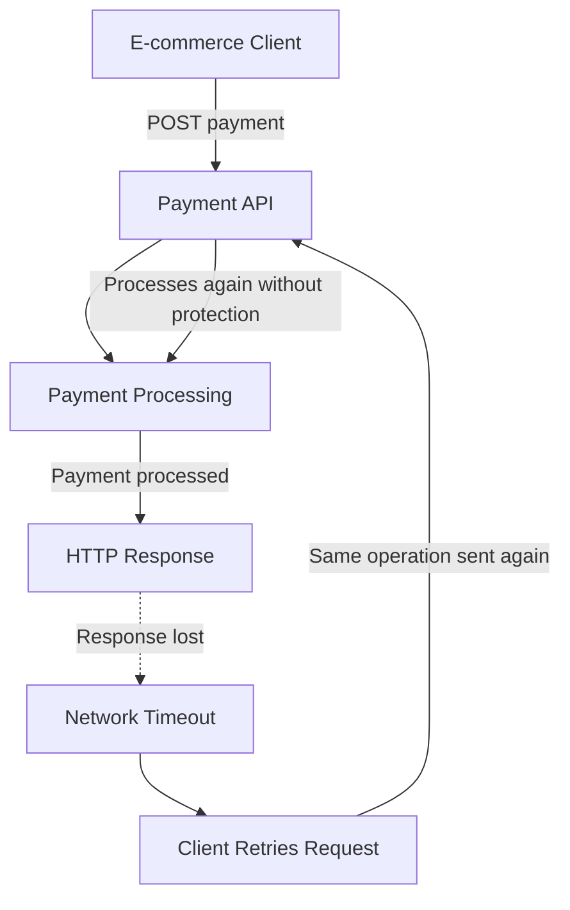
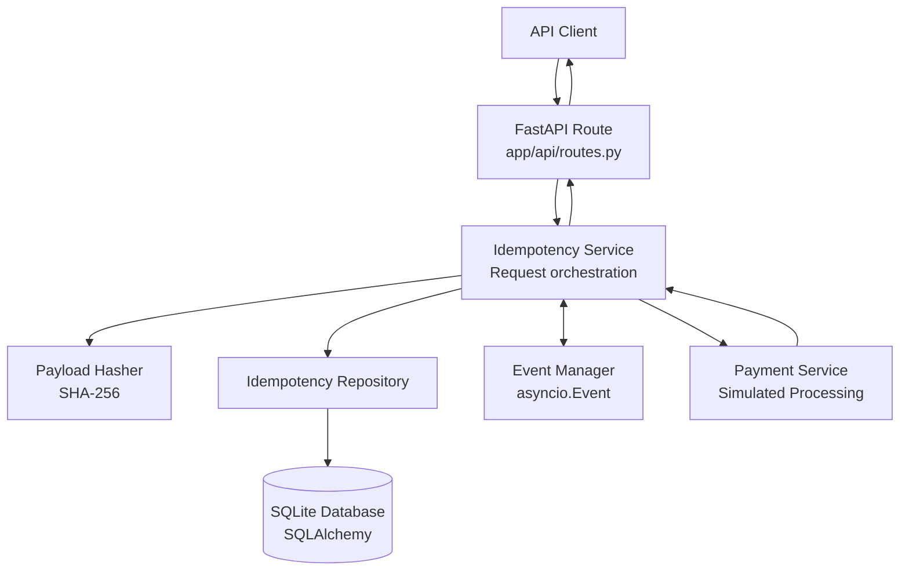
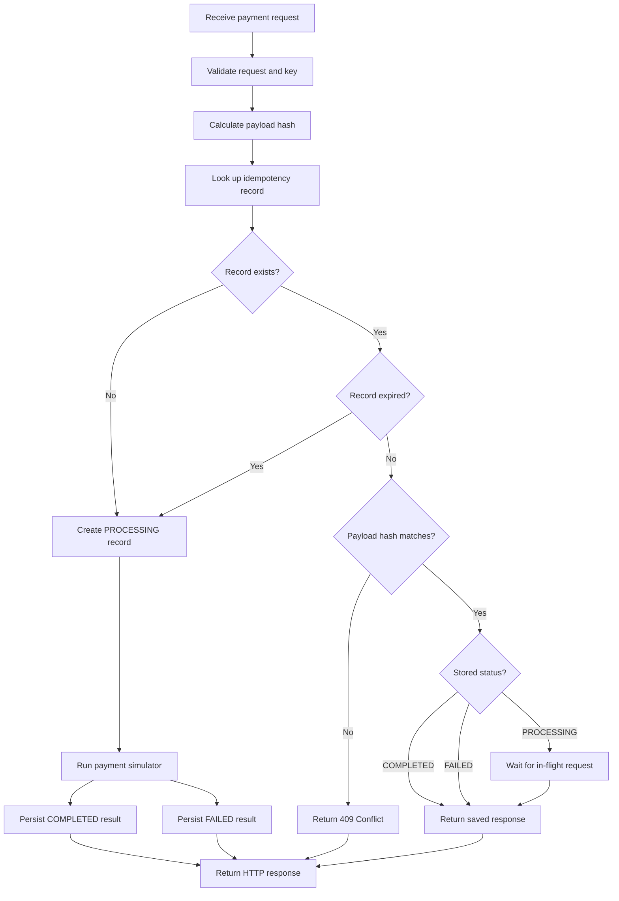
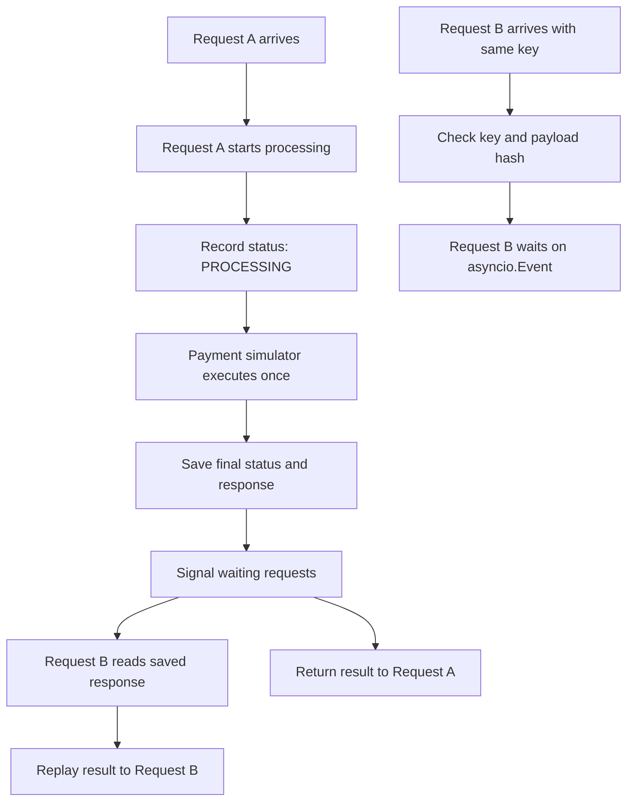

# Building an Idempotency Gateway with FastAPI: From Problem to Deployment

## Introduction

One of the things I enjoy about backend development is that a relatively simple requirement can reveal a much deeper engineering problem.

During the AmaliTech DEG project-based challenges, I worked on an **Idempotency Gateway for Payment Processing**. The objective was to build a REST API that could safely handle repeated payment requests without processing the same operation more than once.

At first, the task appeared straightforward: accept a payment request, process it, and save the response. But once I considered network failures, retries, concurrent requests, and persistence, I realized that the challenge was not simply about returning a response from a FastAPI endpoint. It was about deciding what the server should do when it receives a request that it may already have processed.

I approached the project by breaking the problem down, studying the expected behavior, planning the request flow, implementing the different responsibilities, writing tests, and deploying the API so that other developers could experiment with it.

In this article, I want to share that experience, the decisions I made, what I learned, and where I would take the implementation next.

You can explore the project and try the deployed API through the links below.

- **Source code:** [Idempotency Gateway on GitHub](https://github.com/bendeze/AmaliTech-DEG-Project-based-challenges/tree/main/backend/Idempotency-gateway)
- **Live API documentation:** [Open the Swagger UI](https://amalitech-deg-project-based-challenges-405656c8.fastapicloud.dev/docs)
- **Original challenge:** [Read the project requirements](https://github.com/bendeze/AmaliTech-DEG-Project-based-challenges/blob/main/backend/Idempotency-gateway/OLD_README.md)

## 1. Understanding the Problem Before Writing Code

I started with the challenge requirements rather than immediately creating an endpoint.

The scenario described a payment processor whose clients occasionally experienced network timeouts. When a client did not receive a response, it retried the request. The problem was that the server might already have processed the first payment.

Imagine an online shop sending a request to charge a customer 100 GHS. The server processes the payment, but the response gets lost because of a network problem. From the client's perspective, the result is unknown, so it sends the request again.

Without protection against duplicate processing, the server could execute the payment twice.

The problem can be represented as a topology of the request and the failure:



The important detail was that **a timeout does not necessarily mean that the operation failed**. It only means that the client did not receive the response in time.

That distinction changed how I thought about the problem. I needed a way for the server to recognize that two requests could represent the same intended operation, even when the client had to send the request multiple times.

## 2. Learning About Idempotency

The next step was understanding idempotency and how it applies to APIs.

An operation is idempotent when repeating the same operation produces the same intended effect as performing it once. For a payment endpoint, this requires more than checking whether a request has been received before. The server must associate a request with a stable identifier and retain enough information to recognize and replay its result.

The challenge specified an `Idempotency-Key` HTTP header. The client sends a key with the original request and reuses that key when retrying the same operation.

For example:

```http
POST /process-payment
Content-Type: application/json
Idempotency-Key: payment-1001

{
  "amount": 100,
  "currency": "GHS"
}
```

The first request should be processed normally. If the client sends the same request again with the same key, the gateway should return the saved response rather than execute the payment again.

However, I also needed to consider what should happen if someone reused the same key with a different amount. A request for 100 GHS and a request for 500 GHS must not silently become the same operation.

The challenge also required handling simultaneous requests: if two identical requests arrive while the first one is still being processed, the second request should wait for the first result instead of starting another payment.

These requirements gave me four main cases to design for:

- A new key and a valid payment request.
- An existing key with the same payload.
- An existing key with a different payload.
- An identical request arriving while the original is still processing.

I also wanted to go beyond the minimum requirements. I chose a **time-to-live (TTL)** mechanism so that idempotency records could be treated as expired after a configurable period.

## 3. Planning the Solution

Once I understood the expected behavior, I planned the implementation around clear responsibilities instead of putting every decision inside the API route.

I chose Python and FastAPI for the API, SQLAlchemy for database access, and SQLite for persistence. This combination allowed me to build and run the project without requiring a separate database server. I used asynchronous coordination to handle duplicate requests arriving during an ongoing operation.

The resulting architecture separates the HTTP layer, the idempotency logic, the payment simulator, the persistence layer, and the event manager.



I liked this structure because each component has a specific purpose. The API route handles HTTP concerns, the service coordinates the business flow, the repository manages records, and the payment service simulates the operation being protected.

It also made the implementation easier to test at different levels. I could test hashing independently, test database constraints separately, and exercise the complete API through integration tests.

## 4. Implementing the Idempotency Logic

### Creating a consistent fingerprint for each request

The first important decision was how to determine whether an existing key was being reused for the same request.

I implemented a payload hasher using SHA-256. Before hashing, the JSON payload is serialized in a deterministic format, with object keys sorted and unnecessary whitespace removed. This prevents differences in JSON key ordering from producing different fingerprints for otherwise equivalent objects.

The implementation in `app/services/hasher.py` follows this approach:

```python
import hashlib
import json

def compute_payload_hash(payload) -> str:
    canonical_payload = json.dumps(
        payload,
        sort_keys=True,
        separators=(",", ":"),
        default=str,
    )
    return hashlib.sha256(
        canonical_payload.encode("utf-8")
    ).hexdigest()
```

This illustrates the core idea: convert the request into a stable representation, then calculate its hash.

In the actual project, the hasher also works with the payment request model. The important invariant is that equivalent payloads should produce the same hash, while a meaningful change such as a different amount or currency should produce a different hash.

When a key already exists, the gateway compares the stored hash with the new request's hash. If they differ, it rejects the request with `409 Conflict`.

That check prevents a client from accidentally—or deliberately—reusing an existing idempotency key for a different payment.

### Persisting the state of an operation

Hashing alone was not enough. The gateway also needed to know where each operation was in its lifecycle.

I introduced three states:

- `PROCESSING`: the operation has started but has not completed.
- `COMPLETED`: the operation has finished and its response is available.
- `FAILED`: the operation failed, and its failure information was recorded.

The SQLAlchemy repository stores the idempotency key, request hash, status, response, and timestamps in SQLite. It provides methods to retrieve a record, create a processing record, and update the operation's result.

This is important because the gateway needs to distinguish between a new request, a completed request that can be replayed, and a request that is already being handled.

The main service in `app/services/idempotency.py` coordinates those decisions.



This diagram describes the intended flow at a high level. The actual implementation also includes error handling and event cleanup around the processing path.

### Returning the original result for duplicate requests

For a completed operation, the gateway returns the stored response. It also sets the `X-Cache-Hit` header to indicate whether the result was replayed.

For the first successful request, the header is:

```http
X-Cache-Hit: false
```

For a matching duplicate request, it becomes:

```http
X-Cache-Hit: true
```

For example, a request using the key `payment-1001` and a payload of 100 GHS should receive the same response when the identical request is submitted again:

```json
{
  "message": "Charged 100 GHS"
}
```

The second request should not call the payment simulator again.

I found this distinction useful because the response body alone does not tell the client whether the gateway executed a new operation or replayed an earlier result. The header makes that behavior observable and easier to demonstrate.

### Handling concurrent requests

The more interesting part of the implementation was handling two matching requests that arrive before the first request has completed.

For this, I created an event manager in `app/services/events.py` using Python's `asyncio.Event`. When a request is already in the `PROCESSING` state, a matching duplicate can wait asynchronously for the original operation to finish. Once processing completes, the service reads the stored result and returns it to the waiting request.

The idea is to coordinate concurrent coroutines without making the second request start another payment.



I also ensured that event cleanup occurs in a `finally` block so that completed events do not remain indefinitely in the in-memory event manager.

There is an important limitation to understand here: `asyncio.Event` coordinates requests inside a single Python process. It is not a distributed lock. Multiple application workers or replicas would require a shared coordination mechanism and an atomic way to claim a new idempotency key. I documented this as a production-scaling consideration rather than treating the in-memory event manager as a complete distributed solution.

### Adding a time-to-live mechanism

The additional feature I chose was a configurable TTL, set to 86,400 seconds (24 hours) by default.

Without an expiration policy, idempotency records can accumulate indefinitely. A TTL gives the service a rule for determining when a stored key should no longer be treated as active.

In my implementation, the service checks the record's age when a request arrives. If the record has expired, the repository can reinitialize it for a new operation, updating the request hash and timestamp.

```python
ttl_seconds = 86_400  # 24 hours

is_expired = (
    current_time - record.created_at
).total_seconds() >= ttl_seconds
```

This is a simplified illustration of the expiration check; the project contains the surrounding repository and service logic.

The feature also gave me an opportunity to test the behavior around the expiration boundary, including whether an expired record can be used for a new payload.

For a real payment system, however, expiration must be designed carefully. Allowing a key to trigger a new financial operation after 24 hours can be dangerous if the client retries an old request. A production implementation should define the retry contract and retention policy explicitly, and should not treat TTL as proof that an earlier payment never occurred.

## 5. Testing the Implementation

I did not want the project to rely only on a successful request in Swagger UI. The repository includes a test suite covering individual components, service behavior, database constraints, TTL handling, and API integration.

I organized the tests so that they could verify both expected outcomes and important failure scenarios.

### Testing the individual components

The unit-level tests cover several building blocks:

- `test_hasher.py` checks deterministic hashes, changes in amounts and currencies, and support for dictionary payloads.
- `test_payment_schema.py` checks payment request validation.
- `test_payment_service.py` covers the payment simulator.
- `test_events.py` checks the event manager.
- `test_database.py` verifies that duplicate idempotency keys violate the database's uniqueness constraint.
- `test_idempotency_repository.py` checks repository operations.

These tests help isolate errors. For example, if a payload fingerprint changes unexpectedly, the hasher can be investigated without first debugging the HTTP layer.

### Testing the idempotency service

The service tests in `test_idempotency_service.py` cover more involved scenarios:

- A new payment is processed and its result is persisted.
- A completed request returns its saved response without calling the payment service again.
- A matching request waits while another request is processing.
- A failed payment updates the stored state.
- Waiting requests are released when processing finishes.
- A failed result is handled differently from a completed result.
- Reusing a key with a different payload is rejected.

The concurrency tests are especially valuable. They use asynchronous events to control when the simulated payment begins and finishes, allowing the tests to check that a second request remains pending until the first request is released.

This is more deliberate than simply sending two requests quickly and hoping a race condition occurs during the test.

### Testing the API as a client would use it

The integration tests in `test_api_integration.py` exercise the application through FastAPI's `TestClient`. They use an in-memory SQLite database for the test environment.

The API tests cover:

| Scenario | Expected behavior |
|---|---|
| Health endpoint | Returns HTTP 200 |
| First valid payment | Returns HTTP 200 and `X-Cache-Hit: false` |
| Same key and same payload | Replays the saved response with `X-Cache-Hit: true` |
| Same key and different amount | Returns HTTP 409 |
| Missing idempotency key | Returns HTTP 422 |
| Invalid amount or currency | Returns HTTP 422 |

For the duplicate request, the test checks both the response body and the cache-hit header. For a payload mismatch, it checks the conflict status and the error message.

This matters because an implementation can appear to work while still violating the API contract—for example, by returning the right message but executing the payment simulator twice.

### Testing expiration behavior

The `test_ttl.py` file covers the record's lifetime. It checks that a record within the TTL is replayed, that an older record is treated as expired, and that an expired key can be reused with a different payload under the implemented policy.

The tests simulate time passing by adjusting the stored timestamp, rather than waiting 24 hours during a test.

### Running the tests locally

If you want to reproduce the test suite, clone the repository and enter the gateway directory:

```bash
git clone https://github.com/bendeze/AmaliTech-DEG-Project-based-challenges.git

cd AmaliTech-DEG-Project-based-challenges/backend/Idempotency-gateway
```

Install the dependencies and run the tests with `uv`:

```bash
uv sync
uv run pytest
```

The repository also supports installing the project with `pip` in an appropriate Python 3.12+ environment.

These commands are the documented way to run the suite. Consult the repository for the latest test files and execute the commands in your own environment to confirm the current results.

## 6. Deploying the API and Making It Available

Once the implementation and its tests were in place, I wanted people to be able to interact with the API without first setting up a local Python environment.

The project is available through a deployed API documentation page:

**[Try the Idempotency Gateway in Swagger UI](https://amalitech-deg-project-based-challenges-405656c8.fastapicloud.dev/docs)**

FastAPI's interactive documentation makes it possible to inspect the endpoint, supply request headers, enter a JSON payload, and send a request directly from the browser.

The main endpoint is:

```http
POST /process-payment
```

It expects an `Idempotency-Key` header and a payment body, for example:

```json
{
  "amount": 100,
  "currency": "GHS"
}
```

I encourage you to open the documentation and try the following exercises.

### Exercise 1: Submit a new payment

Send a request with a new key, such as `exercise-payment-001`, and the payload shown above.

Observe the status code, response body, and `X-Cache-Hit` header.

### Exercise 2: Retry the same request

Send the same payload again with the same key.

Compare the response with the first request. Does the gateway replay the result? Is `X-Cache-Hit` now `true`?

### Exercise 3: Reuse the key with a different amount

Keep the original key, but change the amount from 100 to 500.

The gateway should reject the request with a conflict response because the key is already associated with a different payload.

### Exercise 4: Compare different keys

Send the same payment body with a new idempotency key.

Compare the behavior with the earlier exercises. Think about why the key identifies a particular operation rather than simply identifying a payment amount.

### Exercise 5: Explore concurrent requests and TTL

After trying the basic cases, explore the concurrency and expiration tests in the repository. Consider how you would extend the Swagger exercises or write a small client script to send simultaneous requests with the same key.

The concurrency and TTL behavior is particularly worth exploring in automated tests, where you can control the timing and database state more precisely than through manual browser requests.

The deployed documentation provides the interactive interface; the source repository provides the implementation and tests needed to investigate the internal behavior in greater detail.

## 7. What This Project Taught Me

This project helped me connect several backend engineering concepts that are easy to study separately but more meaningful when they come together in a working application.

First, I learned to investigate the failure scenario before choosing a solution. The central issue was not that the client might retry a request; retries are normal in distributed systems. The issue was that the server needed a reliable way to recognize repeated attempts at the same operation.

Second, I saw why persistence matters. A response held only in a local variable disappears when the request finishes. Storing the operation's state and response allows later requests to identify and replay a completed result.

Third, I gained practical experience separating responsibilities. Keeping the API route, hashing, idempotency orchestration, repository, payment simulation, and event manager distinct made the project easier to reason about and test.

Fourth, I learned that concurrency requires explicit design. Two requests can arrive close together, so a check-then-process approach is not sufficient on its own. The implementation needs a way to coordinate work and preserve the relationship between the key and the operation.

Finally, the project made the difference between a working demonstration and a production-ready payment system clearer to me.

### What I would improve next

There are several areas I would address before using this design for real financial transactions.

- **Atomic key claiming:** A unique database constraint is useful, but concurrent requests also need a safe atomic claim-and-recovery flow. A check followed by an insert can race if separate requests or processes execute it simultaneously.
- **Distributed coordination:** Replace process-local event coordination with a design that works across multiple application workers and replicas.
- **Production database:** Evaluate PostgreSQL or another centralized database for concurrent, multi-instance deployments.
- **Failure recovery:** Handle cases where a payment succeeds but the application crashes before the result is persisted. This requires careful reconciliation and, where supported, idempotency at the external payment provider.
- **Retention policy:** Define how long keys and responses must remain available, and make sure expired keys cannot unintentionally authorize duplicate financial operations.
- **Deployment verification and observability:** Add health monitoring, structured logs, metrics, and deployment checks so operational problems can be detected and investigated.

These are not reasons to dismiss the current implementation. They are the next engineering questions that became visible as I worked through the original requirements.

## Conclusion

Building this Idempotency Gateway was a useful exercise in turning a real backend reliability problem into an implementation with explicit rules, persistent state, asynchronous coordination, and automated tests.

What began as a requirement to prevent duplicate payment processing became an opportunity to explore request hashing, database constraints, API contracts, concurrency, TTL policies, and the limits of a single-process design.

I have shared the code and made the API documentation available so that other developers can inspect the implementation and experiment with its behavior.

**Your turn:** open the [deployed API documentation](https://amalitech-deg-project-based-challenges-405656c8.fastapicloud.dev/docs), try the exercises, and then inspect the [GitHub repository](https://github.com/bendeze/AmaliTech-DEG-Project-based-challenges/tree/main/backend/Idempotency-gateway). If you find a scenario I have not covered, consider writing a test for it. That is one of the most useful ways to deepen your understanding of backend reliability.

## References

- [AmaliTech Idempotency Gateway challenge](https://github.com/bendeze/AmaliTech-DEG-Project-based-challenges/blob/main/backend/Idempotency-gateway/OLD_README.md)
- [Project source code and tests](https://github.com/bendeze/AmaliTech-DEG-Project-based-challenges/tree/main/backend/Idempotency-gateway)
- [Deployed interactive API documentation](https://amalitech-deg-project-based-challenges-405656c8.fastapicloud.dev/docs)
- [FastAPI documentation](https://fastapi.tiangolo.com/)
- [SQLAlchemy documentation](https://docs.sqlalchemy.org/)
- [Python asyncio documentation](https://docs.python.org/3/library/asyncio.html)
- [Stripe: Idempotent requests](https://docs.stripe.com/api/idempotent_requests)
