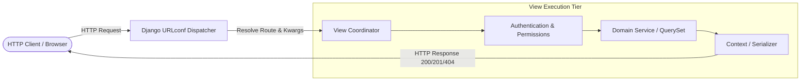
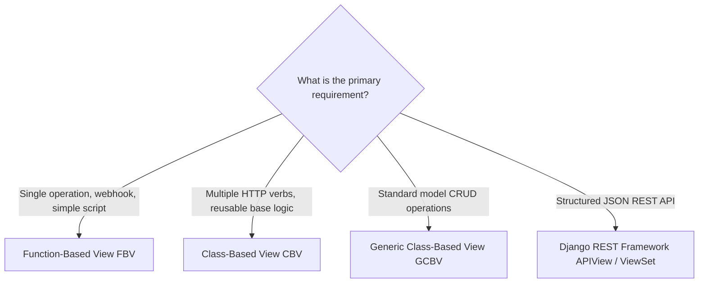
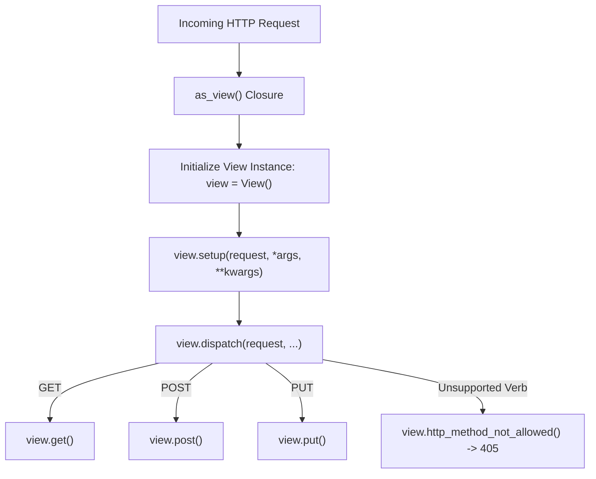
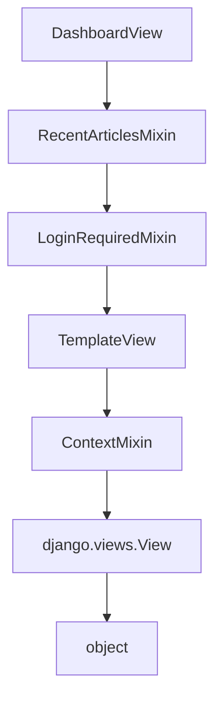
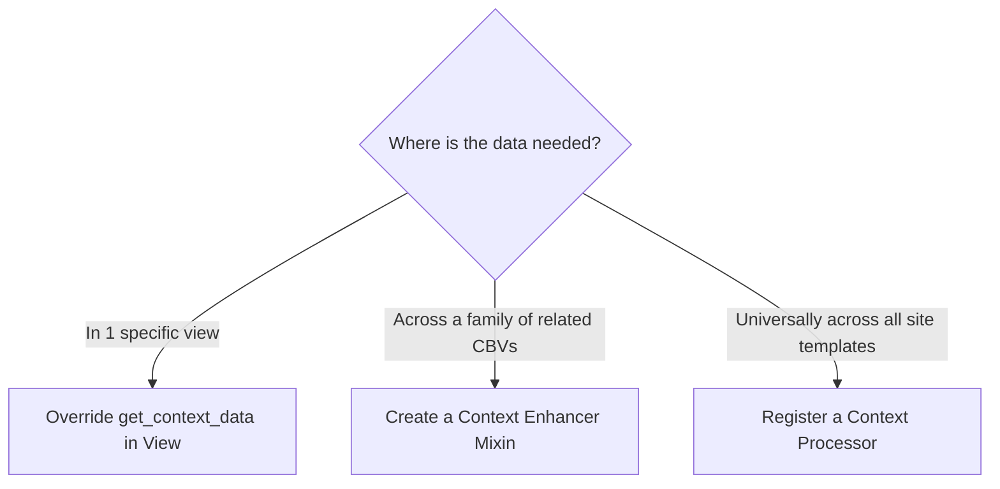
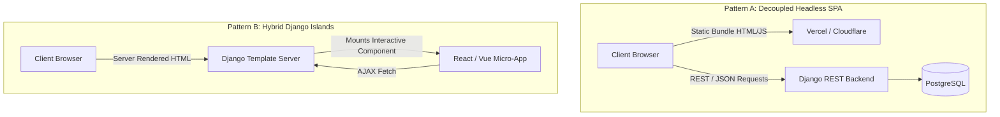
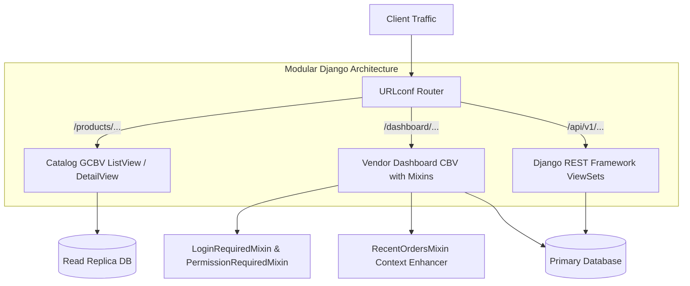

> *"A view does not need to know how the browser reached it. Its sole responsibility is to receive an HTTP request, coordinate the necessary domain operations, and return an appropriate HTTP response."*

In backend engineering, few components have as direct an impact on code maintainability, security, and developer velocity as the routing and request-handling layer. In Django, this layer is defined by **Views and URLs**.

At first glance, handling requests in Django seems trivial: map a string in `urls.py` to a Python function and return an `HttpResponse`. However, as an application transitions from a prototype into an enterprise platform serving diverse clients—web browsers, mobile applications, and third-party microservices—the architectural complexity increases rapidly. 

Without deliberate design, views bloat into multi-hundred-line monolithic functions tangled with validation, database transactions, permissions, and serialization. Concurrently, URL configurations become brittle and haphazardly organized, breaking client integrations whenever paths are refactored.

This architectural guide breaks down the core patterns needed to structure clean, scalable views and URLs in modern Django. We will examine the request-response lifecycle, navigate the trade-offs between function-based and class-based views, safely leverage multiple inheritance via Python's Method Resolution Order (MRO), implement battle-tested view patterns, and design REST-compliant URL hierarchies.

---

## 1. System Anatomy: The Request-Response Pipeline

To design effective views and routing, we must first understand how an HTTP request travels through Django's runtime.

When an HTTP client initiates a connection, the web server (Gunicorn, Uvicorn, or the development server) parses the raw TCP stream into an `HttpRequest` object and passes it to Django's WSGI/ASGI handler.



The request-handling pipeline operates on a deterministic sequence:
1. **Middleware Pre-Processing:** Request middleware executes globally (e.g., security headers, session hydration, CSRF validation, user authentication).
2. **URL Resolution:** Django inspects `settings.ROOT_URLCONF` and evaluates `urlpatterns` sequentially to identify the first matching route.
3. **View Invocation:** The resolved view callable is invoked, receiving the `HttpRequest` instance and any captured positional or keyword arguments (`*args`, `**kwargs`).
4. **Response Generation:** The view returns an `HttpResponse` (or raises an exception such as `Http404` or `PermissionDenied`).
5. **Middleware Post-Processing:** Response middleware processes outgoing headers, cookies, or content encoding before the payload is returned to the client.

At its core, a Django view is defined by a mathematical contract:

```text
View(HttpRequest) -> HttpResponse
```

The `HttpRequest` object encapsulates critical metadata about the request:
- `request.method`: The HTTP verb (`GET`, `POST`, `PUT`, `PATCH`, `DELETE`).
- `request.user`: The resolved user model instance (or an `AnonymousUser`).
- `request.headers`: HTTP headers (Content-Type, User-Agent, Authorization).
- `request.GET` / `request.POST`: Parsed query string parameters and submitted form payloads.

---

## 2. Choosing the Right Abstraction: FBVs, CBVs, and Generic Views

A recurring challenge in Django architecture is selecting the appropriate abstraction for handling incoming requests: **Function-Based Views (FBVs)**, **Class-Based Views (CBVs)**, or **Generic Class-Based Views (GCBVs)**.



### 2.1. Function-Based Views (FBVs)

Function-Based Views are direct, explicit, and easy to trace. There is no hidden inheritance or implicit framework hooks.

```python
# views.py
from django.http import HttpResponse

def health_check_view(request):
    return HttpResponse("System operational", content_type="text/plain")
```

```python
# urls.py
from django.urls import path
from . import views

urlpatterns = [
    path("health/", views.health_check_view, name="health-check"),
]
```

#### When to Use FBVs
- Simple endpoints that handle only one or two HTTP verbs.
- Webhook ingestion endpoints (e.g., Stripe, GitHub) requiring raw payload inspection.
- Highly custom workflows that do not map cleanly to standard CRUD operations.

#### Limitations of FBVs
As branching logic expands, FBVs quickly degrade into complex nested conditional blocks:

```python
# Anti-Pattern: Overburdened Function-Based View
def article_manager(request, pk):
    if request.method == "GET":
        # Fetch and format detail
        ...
    elif request.method == "POST":
        # Process edit form
        ...
    elif request.method == "DELETE":
        # Soft delete record
        ...
    else:
        return HttpResponseNotAllowed(["GET", "POST", "DELETE"])
```

---

### 2.2. Class-Based Views (CBVs)

Class-Based Views solve verb-branching clutter through object-oriented decomposition. Instead of writing monolithic conditional blocks, developers declare separate methods for each HTTP verb (`get`, `post`, `put`, `delete`):

```python
# views.py
from django.http import HttpResponse
from django.views import View

class ArticleEndpointView(View):
    def get(self, request, pk):
        return HttpResponse(f"Displaying article {pk}")

    def post(self, request, pk):
        return HttpResponse(f"Updating article {pk}")

    def delete(self, request, pk):
        return HttpResponse(f"Deleted article {pk}")
```

#### How `as_view()` Works
Because Django's routing system expects a callable function, CBVs expose a factory class method: `as_view()`.

```python
# urls.py
from django.urls import path
from .views import ArticleEndpointView

urlpatterns = [
    path("articles/<int:pk>/", ArticleEndpointView.as_view(), name="article-endpoint"),
]
```

When `as_view()` is invoked at runtime:
1. It returns an inner wrapper closure: `view(request, *args, **kwargs)`.
2. On every incoming request, a **new instance** of the view class is instantiated.
3. The instance calls `setup()`, storing `self.request`, `self.args`, and `self.kwargs`.
4. It calls `dispatch()`, which inspects `request.method.lower()` and routes the request to `self.get()`, `self.post()`, etc.
5. If the incoming HTTP verb does not match an implemented method, `http_method_not_allowed()` automatically returns an `HTTP 405 Method Not Allowed` response.



---

### 2.3. Generic Class-Based Views (GCBVs)

Most web applications repeatedly implement the same database operations: listing records, retrieving single objects, rendering forms, validating input, and redirecting upon success.

Django encapsulates these patterns in **Generic Class-Based Views** (`django.views.generic`):

| Generic View | Primary Purpose | Key Customization Hooks |
| :--- | :--- | :--- |
| `TemplateView` | Renders a template with contextual data | `get_context_data()` |
| `ListView` | Queries and paginates collections of records | `get_queryset()`, `get_paginate_by()` |
| `DetailView` | Fetches a single object by primary key (`pk`) or `slug` | `get_object()`, `get_queryset()` |
| `CreateView` | Renders and validates forms to persist new records | `form_valid()`, `get_form_class()` |
| `UpdateView` | Populates and validates edit forms for existing records | `form_valid()`, `get_object()` |
| `DeleteView` | Handles deletion confirmation and record removal | `form_valid()`, `get_success_url()` |
| `RedirectView` | Redirects clients to another internal or external route | `get_redirect_url()` |

#### Example: Production-Grade `ListView`

```python
# views.py
from django.views.generic import ListView
from .models import Article

class PublishedArticleListView(ListView):
    model = Article
    template_name = "articles/list.html"
    context_object_name = "articles"
    paginate_by = 12

    def get_queryset(self):
        """Optimize query and enforce business state."""
        return (
            Article.objects
            .filter(status="published")
            .select_related("author", "category")
            .only("id", "title", "slug", "published_at", "author__name", "category__name")
            .order_by("-published_at")
        )
```

### 2.4. Class-Based Views vs. Generic Class-Based Views

A common architectural misconception is assuming that all class-based views must inherit from Django's generic CRUD classes.

- **Class-Based View (CBV):** Any class inheriting from `django.views.View`. It provides method dispatching without imposing database or template assumptions.
- **Generic Class-Based View (GCBV):** Specialized subclasses (`ListView`, `DetailView`, `CreateView`) pre-configured with ORM queries and template conventions.

Developers can create custom, reusable base views tailored to their own domain requirements:

```python
# Custom base view for structured JSON micro-endpoints
from django.http import JsonResponse
from django.views import View

class BaseServiceView(View):
    def render_json_error(self, message: str, status_code: int = 400):
        return JsonResponse({"success": False, "error": message}, status=status_code)

    def render_json_success(self, data: dict, status_code: int = 200):
        return JsonResponse({"success": True, "data": data}, status=status_code)
```

---

## 3. Reusability at Scale: Mixins, MRO, and Decorators

As an application grows, views across different domains often share common operational requirements: authenticating users, validating roles, injecting navigation data, or rate-limiting traffic.

Django provides two primary mechanisms to reuse this cross-cutting logic: **Mixins** and **Decorators**.

### 3.1. View Mixins & Multiple Inheritance

A **Mixin** is a focused Python class designed to inject behavior into other classes via multiple inheritance. Mixins should never be instantiated on their own.

Suppose multiple views across a dashboard require access to the five most recently published articles in their template context:

```python
# mixins.py
from .models import Article

class RecentArticlesMixin:
    """Injects recent published articles into the template context."""
    def get_context_data(self, **kwargs):
        context = super().get_context_data(**kwargs)
        context["recent_articles"] = (
            Article.objects
            .filter(status="published")
            .order_by("-published_at")[:5]
        )
        return context
```

We can now compose this mixin into any view:

```python
# views.py
from django.views.generic import TemplateView
from .mixins import RecentArticlesMixin

class DashboardOverviewView(RecentArticlesMixin, TemplateView):
    template_name = "dashboard/overview.html"
```

The call to `super().get_context_data(**kwargs)` is essential: it ensures that data added by other classes in the inheritance chain is preserved.

---

### 3.2. Mixin Ordering & Python's Method Resolution Order (MRO)

Python resolves method calls across multiple parent classes using the **C3 Linearization Algorithm** (Method Resolution Order, or MRO). The order in which mixins are listed directly dictates which class method executes first.

Consider a view inheriting from multiple mixins:

```python
class DashboardView(RecentArticlesMixin, LoginRequiredMixin, TemplateView):
    template_name = "dashboard/overview.html"
```

Python evaluates method overrides from **left to right**:



#### Rules for Safe Mixin Ordering

1. **Place behavior-specific mixins first (leftmost):** Mixins that intercept `dispatch()` (such as `LoginRequiredMixin` or `PermissionRequiredMixin`) must run *before* the base view code executes.
2. **Place the concrete view class last (rightmost):** Base classes such as `TemplateView`, `ListView`, or `View` should terminate the inheritance list.
3. **Always cooperate with `super()`:** Ensure every overridden method invokes `super()` with appropriate arguments so the dispatch chain is not broken.

---

### 3.3. Decorators: Function Wrapping vs. Mixins

Decorators modify or wrap callables without altering their class hierarchy. They are commonly used for authentication, caching, CSRF protection, and rate limiting.

In Function-Based Views, decorators are applied directly:

```python
from django.contrib.auth.decorators import login_required
from django.shortcuts import render

@login_required
def profile_view(request):
    return render(request, "users/profile.html")
```

For Class-Based Views, decorators cannot be attached directly to the class because URL routing executes the `dispatch()` method on the instance. Django provides `@method_decorator` to bridge this gap:

```python
from django.utils.decorators import method_decorator
from django.contrib.auth.decorators import login_required
from django.views.generic import TemplateView

# Decorate the entire class by targeting the 'dispatch' method
@method_decorator(login_required, name="dispatch")
class ProfileView(TemplateView):
    template_name = "users/profile.html"
```

#### Comparison Matrix: Mixins vs. Decorators

| Dimension | View Mixins | Decorators |
| :--- | :--- | :--- |
| **Paradigm** | Object-Oriented (Inheritance) | Functional (Higher-Order Functions) |
| **Primary Use Case** | Injecting methods, context data, or modifying querysets | Intercepting execution (`request`/`response`), authentication, caching |
| **Applicability** | Exclusively Class-Based Views | Both FBVs and CBVs (via `@method_decorator`) |
| **Architectural Risks** | MRO conflicts, subtle method shadowing | Less customizable via class-level attributes |

---

## 4. Production View Design Patterns

To maintain clean boundaries between HTTP coordination and domain logic, developers rely on three proven view patterns.

### 4.1. Pattern 1: Access-Controlled Views

#### The Problem
Modern web backends require multi-tiered security. Unauthenticated users must be redirected to login pages, staff members should be authorized for administrative controls, and tenants must be prevented from inspecting records belonging to other customers.

#### The Architectural Solution
Combine Django's authentication mixins with **QuerySet scoping**:

```python
from django.contrib.auth.mixins import LoginRequiredMixin, PermissionRequiredMixin
from django.views.generic import ListView
from .models import Invoice

class InvoiceListView(LoginRequiredMixin, PermissionRequiredMixin, ListView):
    model = Invoice
    template_name = "billing/invoice_list.html"
    context_object_name = "invoices"
    permission_required = "billing.view_invoice"

    def get_queryset(self):
        """
        Object-level authorization: Enforce tenant isolation.
        Authentication confirms identity; QuerySet scoping guarantees authorization.
        """
        return (
            Invoice.objects
            .filter(organization=self.request.user.organization)
            .select_related("customer")
            .order_by("-created_at")
        )
```

> [!CAUTION]
> Authentication (`LoginRequiredMixin`) verifies *who the user is*. It does **not** authorize *which specific rows they can read or edit*. Never rely solely on URL parameters like `/invoices/<id>/` without verifying object-level ownership in `get_queryset()` or `get_object()`.

---

### 4.2. Pattern 2: Context Enhancers

#### The Problem
Many pages need shared UI state: user notification counts, feature flags, global alert banners, or site metadata. Adding duplicate ORM calls to every individual view violates DRY principles and creates maintenance hazards.

#### The Architectural Solution
Django offers three distinct mechanisms for injecting template context. Selecting the right one depends on **scope and coupling**:



1. **View Method (`get_context_data`):** Use when data is unique to a single endpoint.
2. **Context Enhancer Mixin:** Use when data belongs to a specific subset of views (e.g., e-commerce checkout flows).
3. **Context Processor:** Use when data must appear across all rendered templates (e.g., Google Analytics ID, active maintenance banners):

```python
# context_processors.py
def site_environment(request):
    """Expose global environment metadata across all rendered templates."""
    return {
        "ENVIRONMENT_NAME": "production",
        "SUPPORT_EMAIL": "support@example.com",
    }
```

---

### 4.3. Pattern 3: Machine-Readable Service Views

#### The Problem
Modern applications do not serve human browsers exclusively. Mobile apps, third-party microservices, automated scripts, and AJAX widgets need clean, structured machine data rather than heavy HTML documents.

#### The Architectural Solution
Provide lightweight JSON service views using Django's `JsonResponse`:

```python
# views.py
from django.http import JsonResponse
from django.views import View
from .models import Product

class ProductAutocompleteServiceView(View):
    def get(self, request):
        term = request.GET.get("q", "").strip()
        if not term:
            return JsonResponse([], safe=False)

        products = list(
            Product.objects
            .filter(is_active=True, name__icontains=term)
            .values("id", "name", "price")[:10]
        )
        return JsonResponse(products, safe=False)
```

#### Scaling Beyond Simple Service Views
While `JsonResponse` works well for isolated lookups, enterprise APIs require serialization, schema validation, rate limiting, and token authentication. For full API architectures, adopt **Django REST Framework (DRF)**:

```python
# Modern DRF alternative for enterprise APIs
from rest_framework.views import APIView
from rest_framework.response import Response
from rest_framework.permissions import IsAuthenticated
from .serializers import ProductSerializer
from .models import Product

class ProductListAPI(APIView):
    permission_classes = [IsAuthenticated]

    def get(self, request):
        products = Product.objects.filter(is_active=True)[:20]
        serializer = ProductSerializer(products, many=True)
        return Response(serializer.data)
```

---

## 5. Architectural URL Design & Routing Strategy

Views handle internal logic, but URLs establish the application's **public contract**. A well-architected URL system should be human-readable, predictable, bookmarkable, and stable over time.

### 5.1. Anatomy of a URI

Before writing routing configurations, understand how standard URIs are broken down:

```text
URI = Scheme + Network Location + Path + Query + Fragment
```

```text
https://example.com/articles/django/?page=2#comments
\___/   \_________/ \______________/ \____/ \______/
  |          |             |           |       |
Scheme     Host           Path       Query  Fragment
```

- **Scheme (`https`):** The transport protocol.
- **Network Location (`example.com`):** Identifies the destination server.
- **Path (`/articles/django/`):** The resource hierarchy. **Django's URL dispatcher matches strictly against this path component.**
- **Query (`?page=2`):** Optional parameters accessed via `request.GET`.
- **Fragment (`#comments`):** Client-side document anchor (never sent to the server by browsers).

---

### 5.2. Modular Routing with `include()`

Avoid keeping all routes in a single project-level file. Decompose routing per domain application:

```text
project_root/
├── config/
│   ├── settings.py
│   └── urls.py           # Root URLconf
├── articles/
│   ├── urls.py           # App URLconf
│   └── views.py
└── accounts/
    ├── urls.py           # App URLconf
    └── views.py
```

```python
# config/urls.py (Root)
from django.urls import include, path

urlpatterns = [
    path("articles/", include("articles.urls")),
    path("accounts/", include("accounts.urls")),
]
```

This structure separates concerns and ensures that adding or modifying an application's internal routes does not destabilize the root configuration.

---

### 5.3. Dynamic Path Converters vs. Regular Expressions

Django provides two routing functions: `path()` and `re_path()`.

#### The `path()` Function and Built-in Converters
The `path()` function handles standard URL routing using angled bracket syntax: `<converter:variable_name>`.

```python
# articles/urls.py
from django.urls import path
from . import views

urlpatterns = [
    path("articles/<int:article_id>/", views.article_detail, name="article-detail"),
    path("users/<str:username>/", views.user_profile, name="user-profile"),
]
```

| Converter | Regex Equivalent | Description | Example Match |
| :--- | :--- | :--- | :--- |
| `str` | `[^/]+` | Non-empty string excluding path separator `/` | `<str:slug>` matches `django-tips` |
| `int` | `[0-9]+` | Matches zero or positive integers, returns Python `int` | `<int:pk>` matches `42` |
| `slug` | `[-a-zA-Z0-9_]+` | Matches ASCII letters, digits, hyphens, and underscores | `<slug:post_name>` |
| `uuid` | `[0-9a-f]{8}-[0-9a-f]{4}-...` | Matches formatted UUID strings, returns Python `UUID` | `<uuid:token>` |
| `path` | `.+` | Matches any non-empty string, **including `/`** | `<path:filepath>` |

#### The `re_path()` Function
When routes demand exact character counts or strict regex constraints, use `re_path()`:

```python
from django.urls import re_path
from . import views

urlpatterns = [
    # Match strictly four digits for archival year
    re_path(
        r"^articles/(?P<year>[0-9]{4})/$",
        views.article_archive,
        name="article-archive",
    ),
]
```

Named capture groups `(?P<name>pattern)` pass matched substrings to the view as keyword arguments (`year="2026"`).

#### Routing Selection Guide

| Requirement | Preferred Mechanism | Rationale |
| :--- | :--- | :--- |
| Standard entity ID (`/users/12/`) | `path("users/<int:pk>/")` | Simple, type-safe Python integer conversion |
| SEO Post Slug (`/posts/django-views/`) | `path("posts/<slug:slug>/")` | Clean, readable syntax |
| Strict 4-digit Year (`/archive/2026/`) | `re_path(r"^archive/(?P<year>[0-9]{4})/$")` | Prevents invalid values like `/archive/99/` |
| Custom Currency Code (`/rates/USD/`) | Custom Path Converter | Reusable across multiple routes without regex clutter |

---

### 5.4. Names, Namespaces, and Reverse Resolution

Hardcoding raw URL paths like `href="/articles/42/"` inside views and templates creates fragile applications. If the route changes to `/blog/42/`, every hardcoded reference breaks.

Django resolves this with **Reverse URL Resolution**:

```python
# articles/urls.py
app_name = "articles"  # Namespace declaration

urlpatterns = [
    path("<int:article_id>/", views.article_detail, name="detail"),
]
```

In Python code, reverse URLs using `reverse()`:

```python
from django.urls import reverse

# Returns "/articles/42/"
url = reverse("articles:detail", kwargs={"article_id": 42})
```

In templates, use the `url` tag:

```django
<a href="">
    {{ article.title }}
</a>
```

Namespaces (`app_name = "articles"`) prevent name collisions when multiple apps define a generic route name like `"detail"` or `"list"`.

---

### 5.5. The Critical Importance of Pattern Order

Django evaluates routes in `urlpatterns` from top to bottom and terminates at the **first match**. Placing greedy patterns above specific patterns introduces routing bugs:

```python
# BUG: The slug pattern matches "about", preventing the static route from executing!
urlpatterns = [
    path("articles/<slug:slug>/", views.article_detail, name="article-detail"),
    path("articles/about/", views.article_about, name="article-about"),
]
```

```python
# FIX: Place specific routes before generalized dynamic patterns
urlpatterns = [
    path("articles/about/", views.article_about, name="article-about"),
    path("articles/<slug:slug>/", views.article_detail, name="article-detail"),
]
```

---

## 6. URL Taxonomy: Hierarchical vs. RESTful Patterns

URL design is an architectural decision. The URL hierarchy should reflect resource relationships rather than internal database schemas.

### 6.1. Department Store URLs (Hierarchical)

Hierarchical URLs organize resources like sections in a department store:

```text
/store/
/store/electronics/
/store/electronics/phones/
/store/electronics/phones/smartphones/
```

- Each progressive segment narrows the scope.
- Truncating the URL path backward leaves the user at a logical parent category.
- Ideal for e-commerce, documentation platforms, blogs, and content directories.

---

### 6.2. RESTful URLs (Resource-Oriented)

In Representational State Transfer (REST), URLs identify **resources (nouns)**, while HTTP methods communicate the **action (verbs)**:

| HTTP Verb | Endpoint Path | Intent |
| :--- | :--- | :--- |
| `GET` | `/api/v1/articles/` | Retrieve a list of articles |
| `POST` | `/api/v1/articles/` | Create a new article |
| `GET` | `/api/v1/articles/10/` | Retrieve article #10 |
| `PUT` | `/api/v1/articles/10/` | Replace article #10 entirely |
| `PATCH` | `/api/v1/articles/10/` | Partially update fields on article #10 |
| `DELETE` | `/api/v1/articles/10/` | Remove article #10 |

```text
Avoid anti-pattern action URLs:   /articles/10/delete/
Prefer standard RESTful verbs:     DELETE /articles/10/
```

---

## 7. Decoupled Architecture: Interfacing Django with React and Vue

Modern web applications frequently separate the presentation layer from the Python backend. While classic Django rendered HTML templates directly on the server, contemporary architectures combine Django with JavaScript frameworks such as React or Vue.



### Architectural Comparison

| Architecture | How It Works | Strengths | Trade-offs |
| :--- | :--- | :--- | :--- |
| **1. Decoupled Headless API** | Django functions solely as a JSON API; React/Vue runs as an independent SPA | Independent deployments, clean backend/frontend separation, serves mobile apps | Requires API authentication (JWT/cookies), CORS configuration, extra infrastructure |
| **2. Page-Specific Endpoints** | Traditional Django templates serve HTML, fetching page state from custom `/api/page/` routes | Easier gradual migration for legacy applications | Can lead to single-use API endpoints that lack general reusability |
| **3. Hybrid Islands** | Django renders the outer layout and base HTML, mounting React/Vue onto specific DOM nodes | Keeps Django's simple auth and routing while offering rich UI for forms/widgets | Complex build pipeline (Vite integration inside Django templates) |

---

## 8. Real-World Architectural Case Study: Enterprise Marketplace

To see how these concepts cooperate in production, consider an enterprise marketplace platform containing products, orders, vendor dashboards, and external billing integrations:



In this architecture:
1. **Catalog Browsing:** Uses `ListView` and `DetailView` pointing to read-replica databases with heavy caching for high-throughput public traffic.
2. **Vendor Dashboard:** Leverages custom CBVs composed with `LoginRequiredMixin`, `VendorPermissionMixin`, and context enhancer mixins, enforcing strict tenant isolation in `get_queryset()`.
3. **External & Mobile API:** Uses Django REST Framework ViewSets with token authentication and serializes JSON responses for mobile clients.
4. **URLconf Namespacing:** Cleanly separates `/catalog/`, `/dashboard/`, and `/api/v1/` into isolated routing modules.

---

## 9. Architectural Decision Matrix

| Dimension | Recommendation | Rationale |
| :--- | :--- | :--- |
| **FBVs vs. CBVs** | Use FBVs for simple single-verb actions; use CBVs when splitting multiple verbs or sharing logic. | Minimizes boilerplate without creating unneeded inheritance hierarchies. |
| **CRUD Workflows** | Use Generic CBVs (`ListView`, `DetailView`, `CreateView`). | Avoids reinventing pagination, query optimization, and form validation. |
| **Cross-Cutting Logic** | Use Mixins for view state/context; use Decorators for execution guards (auth, caching). | Preserves clean separation of concerns and prevents MRO complexity. |
| **Access Control** | Combine authentication mixins with tenant-scoped QuerySets. | Prevents broken object-level authorization vulnerabilities. |
| **URL Dispatching** | Use `path()` with converters; reserve `re_path()` strictly for complex regex validation. | Enhances readability and prevents cryptic regular expression maintenance. |
| **Route Naming** | Always declare `app_name` namespaces and resolve routes dynamically using `reverse()`. | Eliminates hardcoded URL fragility across templates and tests. |

---

## 10. References & Further Reading

- [Django Official Documentation: Class-Based Views](https://docs.djangoproject.com/en/stable/topics/class-based-views/)
- [Django Built-in Generic Display Views](https://docs.djangoproject.com/en/stable/topics/class-based-views/generic-display/)
- [Django URL Dispatcher and Path Converters](https://docs.djangoproject.com/en/stable/topics/http/urls/)
- [Django Authentication System & View Mixins](https://docs.djangoproject.com/en/stable/topics/auth/default/#limiting-access-to-logged-in-users)
- [Django REST Framework: API Views & ViewSets](https://www.django-rest-framework.org/api-guide/views/)
- Arun Ravindran, *Django Design Patterns and Best Practices*, Second Edition, Packt Publishing, 2018.

