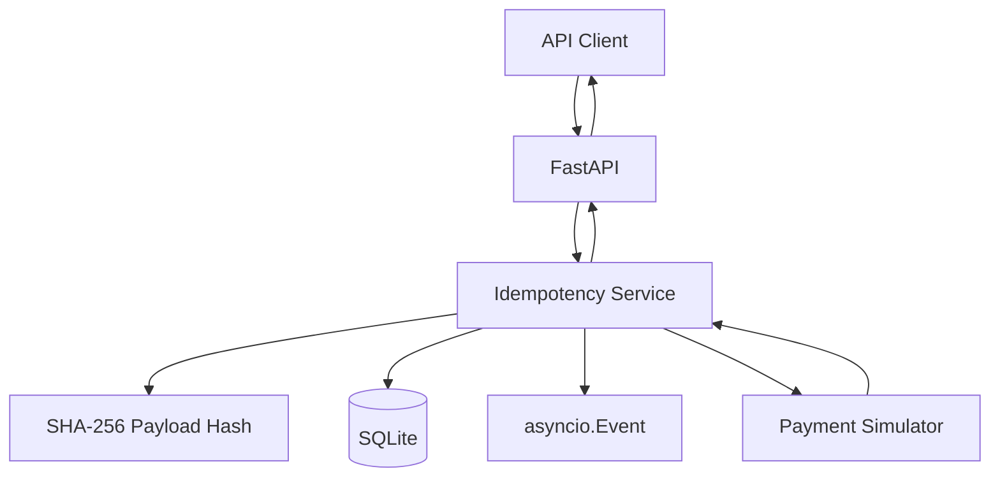

I built an **Idempotency Gateway** as part of the AmaliTech DEG project-based challenges. The goal was to prevent duplicate payment processing when clients retry requests because of network failures or missing responses.

## What Happened?

- **The Goal:** Ensure that retrying a payment request with the same idempotency key does not process the payment twice.
- **The Challenge:** Repeated requests must return the stored response, while reusing the same key with a different payload must be rejected. Concurrent requests also need careful handling.

I used FastAPI, SQLAlchemy, SQLite, and `asyncio.Event` to coordinate concurrent requests within the application process.

```text
Same key + same payload      → Replay stored response
Same key + different payload → HTTP 409 Conflict
Missing idempotency key      → HTTP 422
```

## The Solution / Workaround

I separated the API routes, idempotency service, request hashing, database access, and payment simulator. A SHA-256 hash identifies the request payload, while records track whether processing is `PROCESSING`, `COMPLETED`, or `FAILED`.



I also added tests for request validation, replayed responses, concurrent requests, failures, database constraints, and key expiration.

To run the project locally:

```bash
uv sync
uv run pytest
```

## Thoughts & Next Steps

- [x] Implement idempotency handling and request fingerprinting.
- [x] Add automated tests for core behavior and API integration.
- [ ] Improve coordination across multiple workers and strengthen recovery for real payment-provider failures.

This is a learning project, not a production-ready payment system. Distributed coordination and safe recovery need more work before real financial transactions could rely on it.

**Explore the project:**
- [GitHub repository](https://github.com/bendeze/AmaliTech-DEG-Project-based-challenges/tree/main/backend/Idempotency-gateway)
- [Try the API documentation](https://amalitech-deg-project-based-challenges-405656c8.fastapicloud.dev/docs)

In the API docs, try sending the same request twice with the same `Idempotency-Key`, then change the payload while keeping the key. Compare the responses and the `X-Cache-Hit` header.
