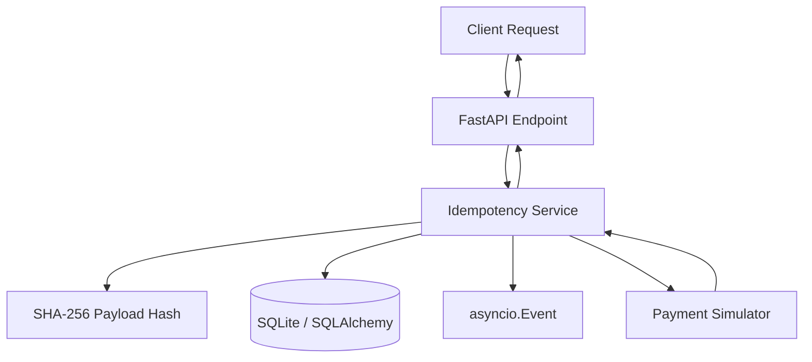

While working on the AmaliTech DEG project-based challenges, I built an **Idempotency Gateway with FastAPI**. What made this challenge interesting to me was that the problem was not simply about processing a payment successfully. It was about what happens when a request is processed but the client never receives the response.

Imagine a client submits a payment, the server processes it, but the connection drops before the response arrives. The client retries, and without proper safeguards, the payment could be processed twice. I wanted to understand how a backend API could handle this situation reliably.

## What Happened?

Before writing the implementation, I broke the problem into a few questions: How would I recognize a retry? How could I distinguish a legitimate retry from a request that reused the same key with different data? And what should happen if two identical requests arrived at nearly the same time?

I decided to use an **idempotency key** supplied by the client to identify a logical operation. But the key alone was not enough: I also needed to compare request payloads and remember the processing result.

I planned the implementation around FastAPI for the API layer, SQLAlchemy and SQLite for persistence, a SHA-256 payload hash for request comparison, and `asyncio.Event` to coordinate matching requests while processing was still underway.

## The Solution / Workaround

I separated the responsibilities into API routes, an idempotency service, request hashing, database access, and a payment simulator. This made it easier to reason about each part instead of mixing payment processing, duplicate detection, and persistence inside one endpoint.

The service tracks requests through `PROCESSING`, `COMPLETED`, and `FAILED` states. A completed request can return its stored response; a matching key with a different payload returns `409 Conflict`. I also implemented a 24-hour time-to-live (TTL) for idempotency records.

I then wrote tests around the behaviors that mattered, including repeated requests, payload mismatches, concurrent requests, validation errors, failure handling, database constraints, and expired keys. Rather than checking only whether an endpoint returned a successful status, I wanted to verify whether the gateway made the correct decision for each situation.

Once the implementation was in place, I made the API available through **FastAPI Cloud**, with interactive documentation so others could exercise the endpoints. The deployed API provides a practical way to explore the behavior beyond reading the code.

## Thoughts & Next Steps

This project taught me to think beyond the happy path. A backend feature is not complete just because one request works; retries, concurrency, failures, and persistence can change the outcome.

There is still an important limitation: `asyncio.Event` coordinates requests only within one application process. A production system with multiple workers would need reliable distributed coordination and stronger recovery mechanisms for uncertain payment-provider outcomes.

You can explore the [source code on GitHub](https://github.com/bendeze/AmaliTech-DEG-Project-based-challenges/tree/main/backend/Idempotency-gateway) or try the [deployed API documentation](https://amalitech-deg-project-based-challenges-405656c8.fastapicloud.dev/docs). Try sending the same payment request twice with the same `Idempotency-Key`, then change the payload without changing the key. Compare the responses and the `X-Cache-Hit` header.

I built this as a learning project, but the problem it explores is very real: **reliable backend systems must account for what happens when things do not go as planned.**
