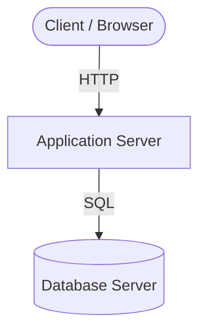
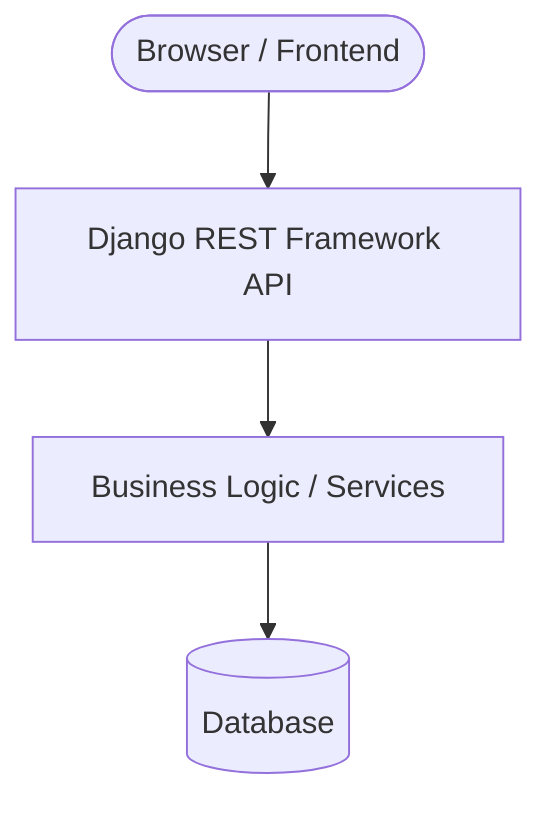

While taking the Coursera Python Backend Engineer course, covering Django, Django REST Framework (DRF), and FastAPI, I came across **N-tier architecture**. I was already familiar with client-server architecture, as well as three-tier and four-tier architectures, but this helped me connect the concepts and understand how they fit together in real applications.

## What Happened?

As I continued learning backend development, I started thinking beyond writing API endpoints and connecting databases. I wanted to understand how the different parts of an application are organized and how they communicate in a production environment.

The important distinction I learned was between **layers and tiers**.

- **Layers** are logical separations of responsibilities within an application, such as presentation, business logic, and data access.
- **Tiers** are physically or infrastructurally separated parts of an application, often deployed on different servers or services.

For example, a Django project can have separate views, services, and models while running on a single server. These are logical layers, not necessarily separate tiers.

### From Client-Server to N-Tier

Client-server architecture describes the relationship between a client and a server. The client sends a request, the server processes it, and a response is returned over a protocol such as HTTP.

N-tier architecture takes this further by separating application responsibilities across multiple deployment environments.

A typical three-tier application looks like this:



The three tiers are:

1. **Presentation tier:** The interface users interact with.
2. **Application tier:** The backend code and business logic.
3. **Data tier:** The database that stores application data.

A four-tier architecture can introduce a separate delivery tier, such as a Content Delivery Network (CDN), to serve static assets like JavaScript, CSS, and images closer to users.

The key takeaway for me was that **N-tier architecture is not limited to three or four tiers**. The number depends on how an application is structured and deployed.

## The Solution / Workaround

To make the concept practical, I mapped it to the kind of backend application I build with Django or FastAPI.

Consider a simple API for retrieving products from a database:



In this example, the diagram shows logical responsibilities. They do not automatically represent four separate physical tiers.

A simplified Django REST Framework endpoint might look like this:

```python
from rest_framework.response import Response
from rest_framework.views import APIView

from .models import Product


class ProductListView(APIView):
    def get(self, request):
        products = Product.objects.all()
        data = [
            {"id": p.id, "name": p.name}
            for p in products
        ]
        return Response(data)
```

The view handles the HTTP request and returns a response, while Django's ORM handles database access. In a larger project, I could move business rules into a service module to keep the view focused on HTTP handling.

With FastAPI, the same basic idea applies:

```python
from fastapi import FastAPI

app = FastAPI()


@app.get("/products")
def list_products():
    return [
        {"id": 1, "name": "Router"},
        {"id": 2, "name": "Switch"},
    ]
```

These examples demonstrate backend responsibilities, but they do not by themselves create a multi-tier deployment. To achieve that, I would deploy the frontend, API, and database separately, potentially adding a CDN or reverse proxy where needed.

## Thoughts & Next Steps

What I found useful is that architecture is not simply about splitting code into folders. It is also about deciding **where components run, how they communicate, and how they can be scaled and secured independently**.

N-tier architecture can improve maintainability, security, and scalability, but it also introduces additional deployment and networking complexity. Separating every component is not always necessary for a small application.

My next step is to apply these ideas to a Django REST Framework or FastAPI project, starting with a clean separation of responsibilities before considering a more distributed deployment.

- [x] Reviewed the difference between layers and tiers.
- [x] Connected client-server architecture with three-tier and four-tier designs.
- [x] Explored how Django and FastAPI fit into a layered backend.
- [ ] Build a small API with a separately deployed frontend, backend, and database.
- [ ] Explore how reverse proxies, caching, and containerization support production deployments.
