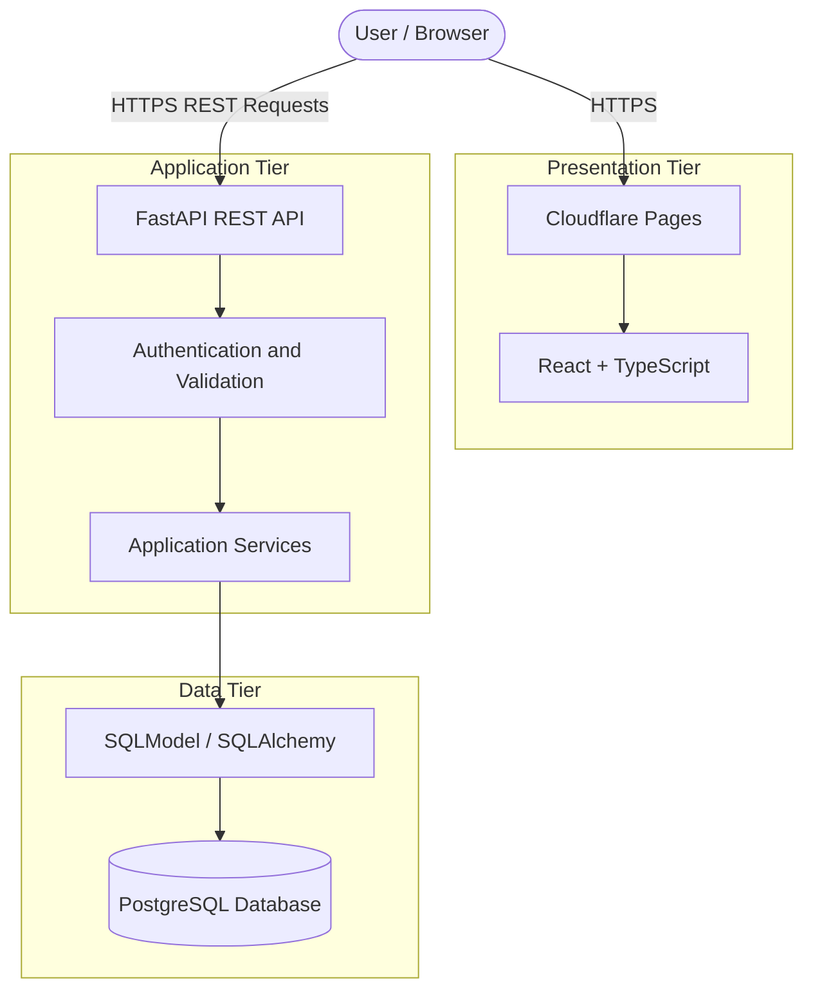
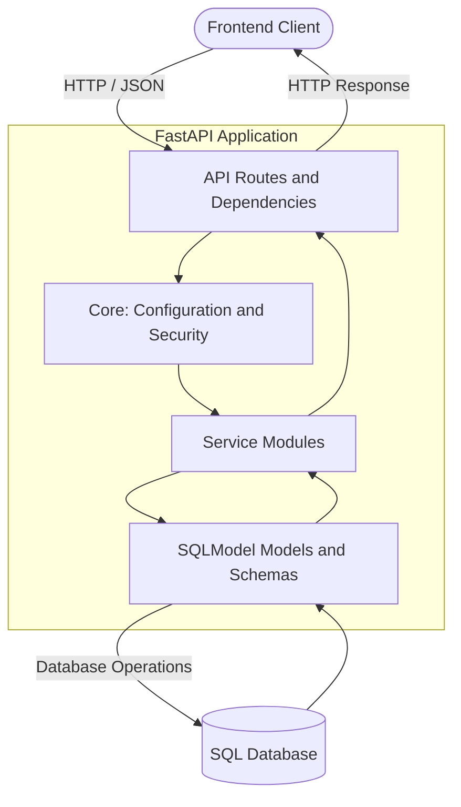
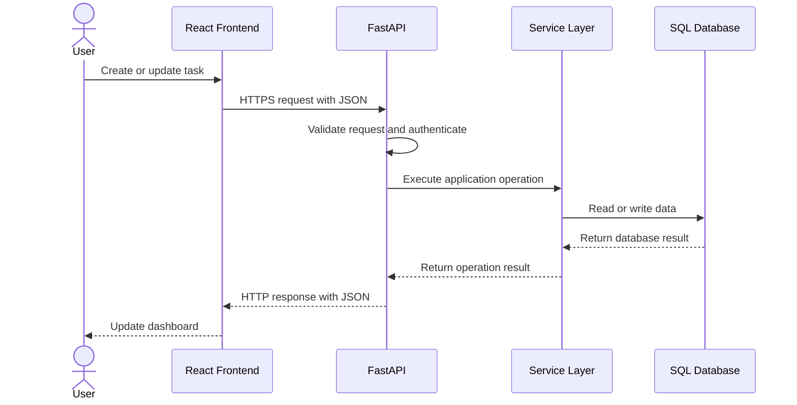

Focus Web is a full-stack productivity application built around intentional work, task management, and focus tracking. It combines a Pomodoro timer, project and task management, productivity analytics, and activity heatmaps in a modern React dashboard.

I am also using this project as a practical exercise in software architecture. Rather than focusing only on building features, I want to understand how an application is structured internally, how its components communicate, and how they can be deployed and maintained independently.

The project uses **React and TypeScript** for the frontend and **FastAPI, SQLModel, and SQL databases** on the backend. My current architectural goal is to separate the presentation, application, and data tiers while maintaining clear layers of responsibility within the backend.

## System Architecture

The project demonstrates two related but different concepts: N-tier architecture and layered architecture.

**N-tier architecture** describes how application components are separated across deployment environments. **Layered architecture** describes how responsibilities are organized within the application code.

The following diagram represents the intended deployment architecture as the project evolves toward independently hosted frontend, backend, and database services.

### Deployment Topology

The frontend is publicly available on Cloudflare Pages. The next deployment milestone is to run the FastAPI backend independently, connect it to a persistent PostgreSQL database, and verify the complete request lifecycle.

This separation will make it possible to configure, troubleshoot, secure, and scale each tier according to its own requirements.

### Backend Layering

The backend also follows a modular structure that separates API handling, configuration and security, data models, and reusable services.

This is a conceptual representation of the backend's responsibilities, rather than a claim that every request must pass through these modules in exactly this sequence.

The important distinction is that these modules can remain separate logical layers even when the entire FastAPI application runs as a single deployed service.

## Key Technical Achievements

1. **Full-Stack Feature Development:** Built a productivity dashboard with a configurable Pomodoro timer, task and project tracking, focus analytics, and activity heatmaps.

2. **Modular Backend Design:** Organized the FastAPI application into API routes, core configuration and security, SQLModel models, and reusable service modules.

3. **API Authentication and Auditing:** Implemented JWT-based authentication and security audit logging, providing a foundation for protected API operations and traceability.

4. **Automated Quality Checks:** Added a pytest suite for backend functionality and a GitHub Actions workflow. The frontend also supports build and type validation.

5. **Architecture-Focused Deployment:** Developing the deployment setup around independent frontend, backend, and database services, with environment-based configuration and secure network communication.

## Database Schema / Data Flow

Focus Web uses SQLModel to define database models and interact with relational databases. The project supports SQLite for local development and PostgreSQL for a more production-oriented deployment.

A typical task operation follows this flow:

The frontend communicates with the API through HTTP requests, while database operations remain on the backend. This means that database credentials and direct database access do not need to be exposed to the browser.

The database connection is configured through environment variables, allowing the development and production environments to use different database instances without changing application code.

For production deployment, the next step is to verify the PostgreSQL configuration, migration process, and persistence of application data across backend restarts.

## Deployment & Production Impact

Focus Web already has a live frontend and a structured backend codebase. The main engineering objective now is to complete and validate the independently deployed application architecture.

- **Frontend Deployment:** React and TypeScript application hosted on Cloudflare Pages.
- **Backend Deployment:** FastAPI REST API, with a separate production deployment and public API endpoint to be documented once configured and verified.
- **Database Deployment:** PostgreSQL is the intended persistent production data tier; SQLite remains available for local development.
- **Security:** JWT authentication, request validation, controlled cross-origin access, and protected database credentials.
- **Testing and Reliability:** Automated backend tests, frontend build validation, and CI checks. End-to-end persistence and deployment checks are part of the next validation stage.

I am deliberately not publishing throughput, latency, availability, or cost-reduction figures until I have measurements from repeatable tests. My next milestone is to verify the complete deployed request path, test authorization and data persistence, and document the results.

This project is an opportunity to connect what I am learning about backend engineering with practical infrastructure decisions. By developing the application and documenting its architecture together, I want to build a clearer understanding of how maintainable application code translates into a secure, deployable system.
