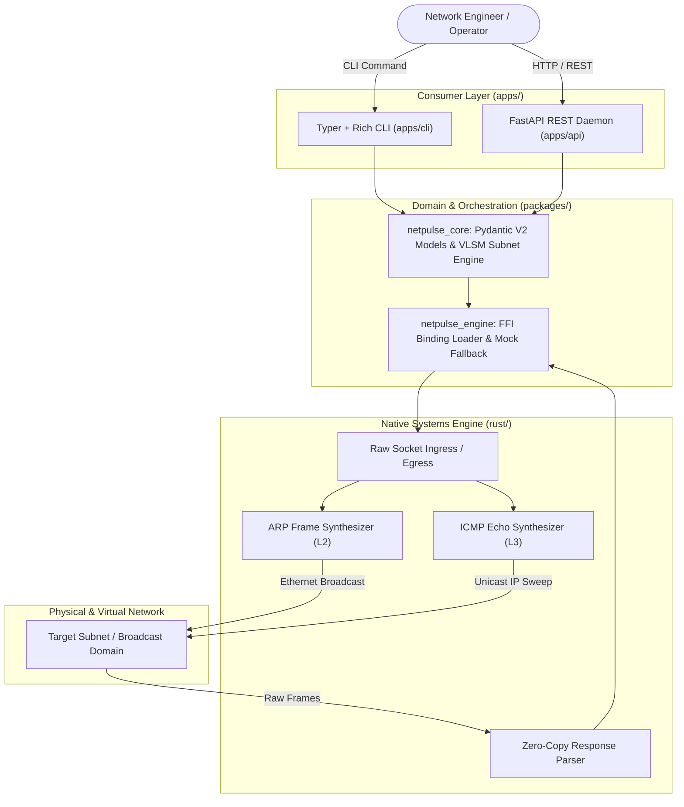
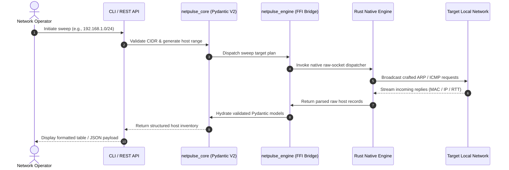

NetPulse is an open-source, high-performance network discovery and diagnostic suite designed to bridge the gap between low-level systems programming and modern developer tooling. In traditional network auditing and infrastructure monitoring, engineers frequently encounter a trade-off: high-level scripting languages like Python provide rapid prototyping and clean abstractions but struggle with raw packet throughput, while low-level C tools can be difficult to integrate into modern web services, automated pipelines, or extensible plugin architectures.

To solve this, NetPulse adopts a **hybrid systems architecture** organized as a modern monorepo. Low-level, latency-critical operations—specifically raw-socket packet synthesis and asynchronous frame capture—are implemented in **Rust** for maximum throughput, predictable memory efficiency, and memory safety without garbage collection pauses. Surrounding this core engine is a modular **Python** layer featuring **Pydantic V2** domain validation, a production-ready **FastAPI** REST daemon, and an interactive **Typer/Rich** terminal interface for command-line diagnostics.

---

## System Architecture

NetPulse is partitioned into clear boundaries across the monorepo to isolate low-level networking privileges, packet processing logic, domain modeling, and user-facing presentation:

### Monorepo Layout & Layer Responsibilities

1. **`rust/` (Native Packet Engine):** Operates at the socket interface level (`AF_PACKET` on Linux / raw sockets). It crafts raw Ethernet ARP frames for Layer 2 broadcast discovery and IPv4 ICMP Echo request packets for Layer 3 host availability scans. Responses are parsed directly from network buffers to minimize memory allocations.
2. **`packages/netpulse_engine` (Binding & Safety Layer):** Serves as the FFI bridge between compiled Rust binaries and the Python runtime. To support development, continuous integration, and test environments where raw socket privileges (`CAP_NET_RAW` / root) are unavailable, this package incorporates a zero-privilege mock fallback provider.
3. **`packages/netpulse_core` (Core Domain Orchestration):** Houses shared Pydantic V2 schemas, network calculation utilities (CIDR parsing, VLSM calculations), and sweep coordination workflows shared across all consumer applications.
4. **`apps/api` (FastAPI REST Service):** Exposes network scanning and health monitoring capabilities over a secure HTTP interface. The daemon is hardened with strict loopback binding (`127.0.0.1:8000`) and schema-validated JSON payloads.
5. **`apps/cli` (Typer CLI Application):** Provides a high-fidelity command-line experience with real-time terminal progress indicators, formatted device tables, and configurable scan parameters.

---

## Key Technical Achievements

1. **Zero-Copy Raw Socket Ingestion:** Bypassed high-level transport abstractions by assembling custom Layer 2 ARP frames and Layer 3 ICMP packets directly in Rust, ensuring deterministic latency during large subnet sweeps.
2. **Cross-Language FFI with Graceful Fallback:** Engineered `netpulse_engine` to cleanly interface compiled native bindings with Python, while maintaining an unprivileged mock provider that enables automated CI runs without requiring elevated network capabilities.
3. **Strict Domain Typing with Pydantic V2:** Consolidated all IP addresses, MAC addresses, sweep targets, and diagnostic metrics into validated Pydantic V2 models, ensuring rigorous data integrity from packet capture to JSON serialisation.
4. **Dual Interface Accessibility:** Designed a flexible interface layer that serves both automated systems via a secured FastAPI REST API and interactive operators via a rich terminal CLI with formatted tables and color-coded host statuses.
5. **Architectural Separation of Privileges:** Decoupled the privileged raw-socket packet engine from the unprivileged API server and CLI consumers, minimizing the security attack surface during enterprise network sweeps.

---

## Network Discovery Flow & Packet Lifecycle

When an operator triggers a subnet scan, the request traverses the architecture from high-level input down to raw network frames and back:

---

## Deployment, Security & Production Impact

NetPulse is built for reliability, security, and integration into modern infrastructure monitoring environments:

* **Privilege Separation:** Raw socket crafting requires `CAP_NET_RAW` permissions or superuser access on Linux. By encapsulating this logic within `rust/` and `netpulse_engine`, the rest of the application stack (FastAPI web server, CLI utilities, and plugins) operates safely with standard user permissions.
* **Secured Local REST Daemon:** The FastAPI daemon is configured by default to bind strictly to localhost (`127.0.0.1:8000`), protecting local network discovery endpoints from external exposure without explicit reverse proxy authentication.
* **Extensible Plugin Architecture:** The monorepo layout includes dedicated `plugins/` entrypoints, allowing teams to append custom fingerprinting rules, service identification modules, or export targets without altering the core packet dispatcher.
* **Automated CI Validation:** The inclusion of a mock engine fallback allows unit and integration test suites in `tests/` to run reliably in containerized CI environments like GitHub Actions without requiring simulated hardware bridges or root access.

