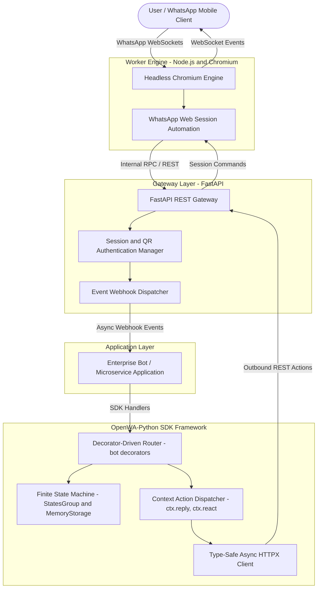
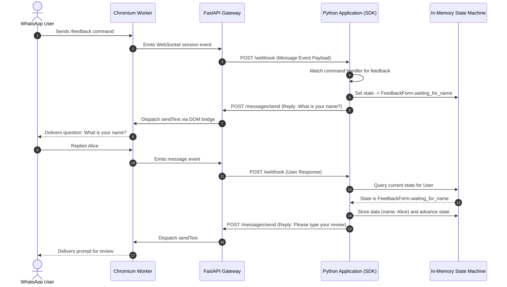

Building automated messaging workflows, customer engagement bots, and transactional notification gateways on WhatsApp has historically presented difficult architectural compromises. Developers either depend on proprietary cloud APIs with restrictive messaging templates and high per-conversation costs, or must orchestrate fragile browser automation scripts that tangle headless Chromium management directly into business application logic.

**OpenWA-Python** solves this by establishing a **clean, decoupled hybrid architecture**:
1. A robust **REST API Gateway** backed by **FastAPI** that isolates headless **Chromium / Node.js** browser automation in an independent worker process.
2. An idiomatic, production-grade **Python Bot SDK (`openwa-sdk`)** providing decorator-driven routing (`@bot.on_command`, `@bot.on_message`), type-safe asynchronous clients via **HTTPX** and **Pydantic V2**, and a built-in **Finite State Machine (FSM)** for multi-step interactive conversations.

---

## System Architecture

OpenWA-Python separates browser process management, API translation, event streaming, and conversational application logic into distinct, fault-tolerant tiers:

### Core Architecture Components

* **Decoupled Chromium Worker:** WhatsApp Web protocol sessions require an active browser runtime. Rather than running Node.js and Chromium inside the primary Python service, the worker operates as an isolated daemon. If a browser tab or rendering thread crashes, it restarts without terminating active Python API connections or losing in-flight state.
* **FastAPI REST Gateway:** Bridges incoming HTTP requests to session automation commands. Exposes standardized endpoints for sending text, interactive buttons, media files, contact vCards, reactions, and managing QR-code authentication.
* **Decorator-Based Router:** Inspired by modern bot engines like Aiogram, developers write expressive, readable routing rules without parsing raw JSON bodies or maintaining nested conditional blocks.
* **Finite State Machine (FSM):** Enables conversational flows (such as customer support intake, onboarding wizards, or survey questionnaires) by binding user chat IDs to structured state progressions with temporary memory persistence.

---

## Key Technical Achievements

1. **Decoupled Hybrid Process Isolation:** Separated resource-intensive Chromium headless rendering from the Python runtime, preventing browser memory leaks from impacting the web gateway and SDK consumers.
2. **Idiomatic Bot Ergonomics:** Built a high-level Python framework featuring `@bot.on_command()`, `@bot.on_message()`, and `@bot.on_event()` decorators, dramatically reducing the boilerplate needed to handle incoming WhatsApp events.
3. **Native Finite State Machine (FSM):** Implemented `StatesGroup`, `State`, and `MemoryStorage` primitives that manage complex multi-turn dialogs without requiring external session databases for basic workflows.
4. **Asynchronous Non-Blocking I/O:** Built entirely on **HTTPX** and Python's **`asyncio`**, ensuring that webhook event delivery, media uploads, and message dispatches never block worker event loops.
5. **Rich Context Actions:** Designed a context object (`ctx`) providing intuitive one-line methods: `await ctx.reply()`, `await ctx.react("🔥")`, `await ctx.quote()`, and media attachments with automatic MIME-type detection.

---

## Multi-Step Conversational Data Flow (FSM)

The following sequence illustrates how OpenWA-Python routes an incoming user message, updates conversational state via the Finite State Machine, and dispatches a context-aware response:

---

## Deployment & Production Impact

* **Framework Agnostic Webhooks:** The SDK's dispatcher (`bot.feed_raw_event()`) integrates into any ASGI/WSGI Python framework, including FastAPI, Starlette, Flask, and Django.
* **Containerized Microservices:** Readily packaged via Docker Compose into two cooperating services—the Node/Chromium worker and the Python FastAPI gateway—enabling independent horizontal scaling and resource limits.
* **Fault-Tolerant Session Reconnection:** Built-in auto-recovery logic monitors WhatsApp Web connection dropouts, re-establishing session sockets and notifying webhook subscribers when QR re-authentication is required.
* **Type Safety & Data Integrity:** Full Pydantic V2 models for incoming chats, messages, participants, reactions, and media metadata guarantee strict runtime type validation across all handlers.

